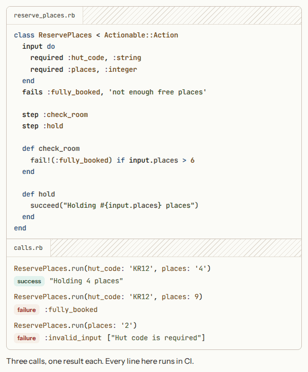

# gems

Ruby gems for typed data and the actions that move it around, plus the
adapters that carry both into other formats. One repo, one docs site, each
gem published on its own.

<a href="https://gliders-rb.github.io/">
  <picture>
    <source media="(prefers-color-scheme: dark)" srcset="site/public/hero/hero-dark.gif">
    
  </picture>
</a>

| Gem | Path | What it does |
|---|---|---|
| `field_struct` | `gems/field_struct` | Plain Ruby objects with declared fields that coerce, check presence and validate |
| `actionable-rb` | `gems/actionable` | Action objects with declared input, steps and outcomes |
| `field_struct-json_schema` | `adapters/field_struct-json_schema` | JSON Schema from a struct class |
| `field_struct-avro` | `adapters/field_struct-avro` | Avro schemas, encode and decode, schema evolution |
| `field_struct-avro-native` | `adapters/field_struct-avro-native` | An optional Rust encoder for `field_struct-avro`, same bytes, faster |
| `field_struct-protobuf` | `adapters/field_struct-protobuf` | Protobuf descriptors, `.proto` output and messages (API may change) |
| `actionable-otel` | `adapters/actionable-otel` | OpenTelemetry spans for action runs and steps |
| `actionable-tools` | `adapters/actionable-tools` | Actions as LLM and MCP tools |
| `actionable-docs` | `adapters/actionable-docs` | Process pages for actions: Markdown and a Mermaid chart (API may change) |

The docs site lives in `site/`.

## Working here

Each gem is self-contained. From its directory:

```sh
bundle install
bundle exec rake                 # specs + rubocop
bundle exec rake release:check   # adds doctests, signatures and YARD
```

From the repo root, `bin/oracle` runs every gem's default task, then runs its
suite again with ActiveSupport loaded first, and fails if any run fails.
Nothing is done until it passes. `bin/oracle --rails` also runs
`integration/rails`, a one-file Rails app that uses the gems the way an app
does: params, `render json:`, transactions, jobs and eager loading.

Gems that depend on each other point at the local copy through `path:` in
their Gemfile, so a change in `field_struct` is tested against every adapter
before it ships.

## History

FieldStruct and Actionable started as ideas I carried for years. Their first implementations grew up with the support of Acima and later Paymentbox, and both companies released them as open source under the MIT license. I'm grateful to both, and to the colleagues there who used the early versions and pushed back on them, for the room to try these ideas in real systems.

This repository is a complete rewrite. Design specs were written by studying how the earlier versions behaved, and the new code was written from those specs alone, without access to the earlier code. The public API keeps the same names on purpose, so the ideas stay familiar, and everything under it is new. The earlier versions are not maintained here, and neither company is involved in or endorses this project.

## License

MIT, Copyright (c) 2026 Adrian Madrid. Each gem carries its own
`LICENSE.txt`.
